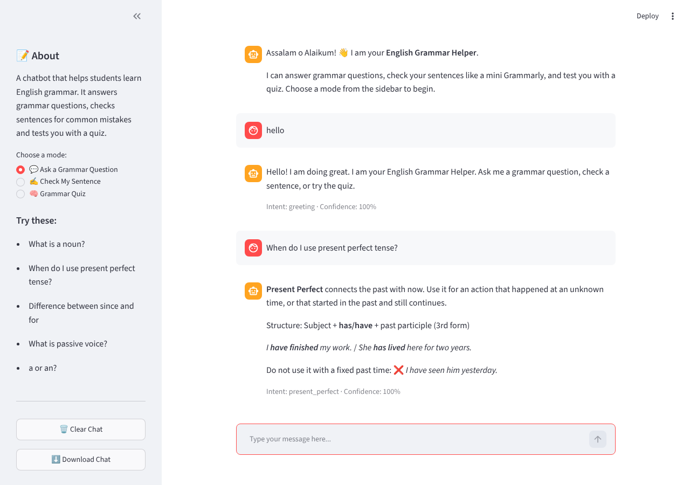

# English Grammar Helper Chatbot

A domain-specific chatbot that helps students learn English grammar. It answers grammar questions, checks sentences for common mistakes (like a simple Grammarly), and tests the user with a multiple-choice grammar quiz.

**Student:** Muneeb  
**Roll No:** 073  
**Topic No:** 23 – English Grammar Helper



## Features

- **Ask a Grammar Question** – answers 30+ grammar topics (tenses, parts of speech, a/an, since/for, active/passive, etc.)
- **Check My Sentence** – finds and explains common mistakes: spelling, a/an, he/she/it + verb, wrong phrases (e.g. *i is*, *more better*), repeated words, capital letters and missing full stop
- **Grammar Quiz** – 10 random MCQs from a bank of 20, with instant feedback and a final score
- Handles greetings (hello, salam, hi) and farewells (bye, Allah Hafiz, thank you)
- Tolerates different wording, upper/lower case, extra punctuation and minor spelling mistakes
- Polite fallback reply for unknown questions
- Shows the predicted intent and confidence score for each reply
- Download the conversation as a text file
- Clear Chat button; chat history kept during the session

## Technologies Used

- Python 3.10+
- Streamlit (interface)
- Python standard library: `json`, `re`, `random`, `difflib`, `pathlib`

## Project Structure

```
073_Muneeb_Chatbot/
├── app.py               # Streamlit interface
├── chatbot.py           # Intent matching for grammar questions
├── grammar_checker.py   # Sentence checking rules
├── quiz.py              # Quiz logic
├── data/
│   ├── intents.json        # Grammar Q&A knowledge base
│   ├── grammar_rules.json  # Spelling list and grammar rules
│   └── quiz.json           # Quiz questions
├── requirements.txt
├── README.md
└── screenshot.png
```

## Installation

```bash
pip install -r requirements.txt
```

## How to Run

```bash
streamlit run app.py
```

The app opens in your browser at `http://localhost:8501`.

## Sample Questions

| Mode | Try typing |
|---|---|
| Ask a Grammar Question | What is a noun? · When do I use present perfect tense? · Difference between since and for |
| Check My Sentence | he go to school every day · She have a apple · We was going to the libary |
| Grammar Quiz | start → then A / B / C / D → stop |
